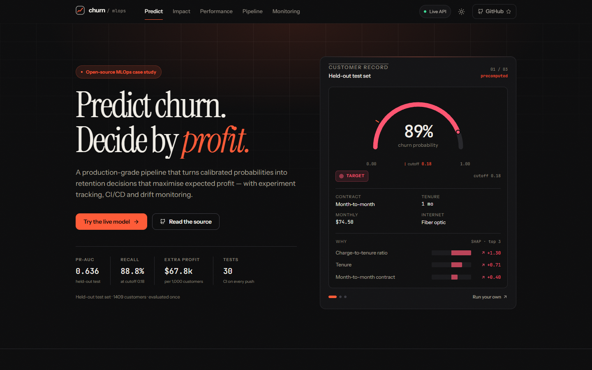
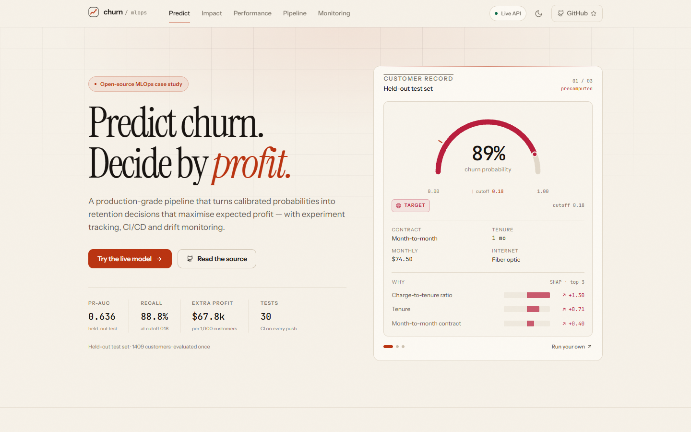
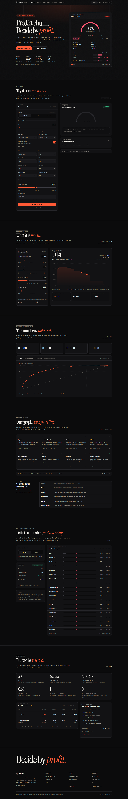
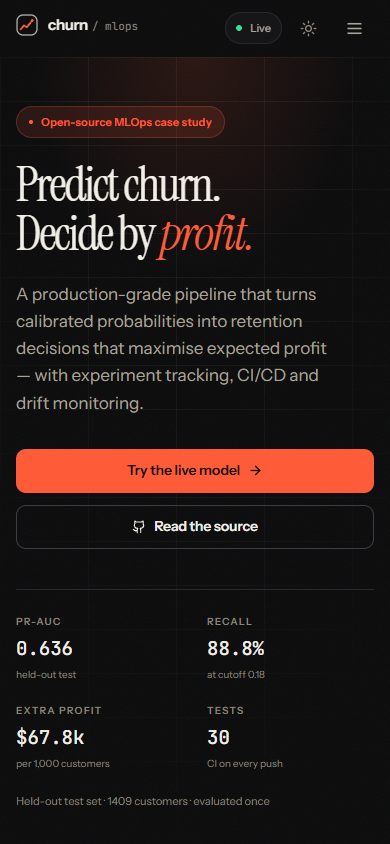

# churn-mlops

> Predict churn. Decide by profit.

An open-source, end-to-end MLOps case study. The pipeline turns the public IBM Telco Customer Churn
dataset into **calibrated probabilities**, chooses a **cost-based decision cutoff** instead of 0.5,
serves predictions through a typed API, and monitors the inputs for drift. The website is a live
front-end for that pipeline — every number on it comes from the exported pipeline artifacts.

- **Site:** https://kuldeepni.github.io/churn-mlops/
- **API:** https://kuldeepni-churn-mlops-api.hf.space
- **API docs:** https://kuldeepni-churn-mlops-api.hf.space/docs
- **Source:** https://github.com/Kuldeepni/churn-mlops

## Interface

The redesign, "The Churn Ledger", treats a retention decision as a financial entry: warm ink and
paper, hairline rules, tabular figures, Instrument Serif display type and one vermilion accent for
the moment money moves. Dark mode is the night desk; light mode is the printed report.

| | |
| --- | --- |
|  |  |
|  |  |

The predictor accepts all 19 model inputs and returns a probability, a profit-based decision and
the top three SHAP drivers. The impact section recomputes the optimal cutoff in the browser from
1,409 exported validation scores; the deployed `0.18` cutoff is shown separately because it comes
from the pipeline's own validation run. The monitoring section switches between two real simulated
traffic samples (`no_shift` and `shifted`) and explains every PSI flag.

## Measured results

Evaluated once on 1,409 held-out customers. All values are read from `reports/metrics.json` and
`web/public/data/`:

| Metric | Value |
| --- | --- |
| PR-AUC | 0.636 (95% CI 0.586–0.683) |
| ROC-AUC | 0.846 |
| Recall at cutoff 0.18 | 88.8% |
| Brier score (calibrated) | 0.135 |
| Net benefit at cutoff 0.18 | $67,792.76 per 1,000 customers |
| Deployed decision cutoff | 0.18 |
| Pipeline tests / coverage | 30 / 69.85% |
| Quality gate | PR-AUC ≥ 0.60 and recall ≥ 0.40 |

Model selection compared a logistic baseline with a tuned LightGBM over five folds; logistic won on
PR-AUC and Brier score and is the model that ships. Probabilities are isotonically calibrated on
the validation split.

## What is in the repo

- `src/churn/` — ingest, Pandera validation, feature engineering, training, calibration, threshold
  optimisation, evaluation, FastAPI serving and drift detection.
- `dvc.yaml` — six reproducible stages driven by `params.yaml` (seed 42).
- `models/`, `reports/`, `data/` — generated artifacts, intentionally not committed.
- `web/` — the React/Vite front end and the JSON snapshot served from `web/public/data/`.
- `.github/workflows/` — CI (lint, a Python 3.10–3.12 test matrix, DVC repro, Docker smoke test)
  and the GitHub Pages build/deploy workflow.

## Quickstart

```bash
uv venv && uv pip install -e ".[dev]"   # or: make install
make repro                              # ingest -> clean/split -> train -> calibrate -> threshold -> evaluate
make serve                              # http://127.0.0.1:8000/docs
```

Regenerate the front-end snapshot from the latest pipeline outputs:

```bash
python scripts/export_frontend_data.py
```

Run the website locally:

```bash
cd web
npm ci
npm run dev
```

`npm run build` uses `/` as the base path by default. The Pages workflow sets
`VITE_BASE_PATH=/churn-mlops/` and `VITE_API_URL=https://kuldeepni-churn-mlops-api.hf.space`.

### Front-end scripts

| Command | Purpose |
| --- | --- |
| `npm run typecheck` | TypeScript checks |
| `npm run lint` | ESLint |
| `npm run test` | Vitest: profit optimiser, nearest-neighbour demo, API retries |
| `npm run build` | Production bundle |
| `npm run og` | Render `public/og-image.png` from the real metrics |
| `npm run shots` | Capture dark/light, desktop/mobile, chart-tab and demo-mode screenshots |

`scripts/screenshots.mjs` expects a preview server on port 4173 (`npm run preview`).

## License

MIT — see [LICENSE](LICENSE). Uses the public IBM Telco Customer Churn dataset; not affiliated with IBM.
